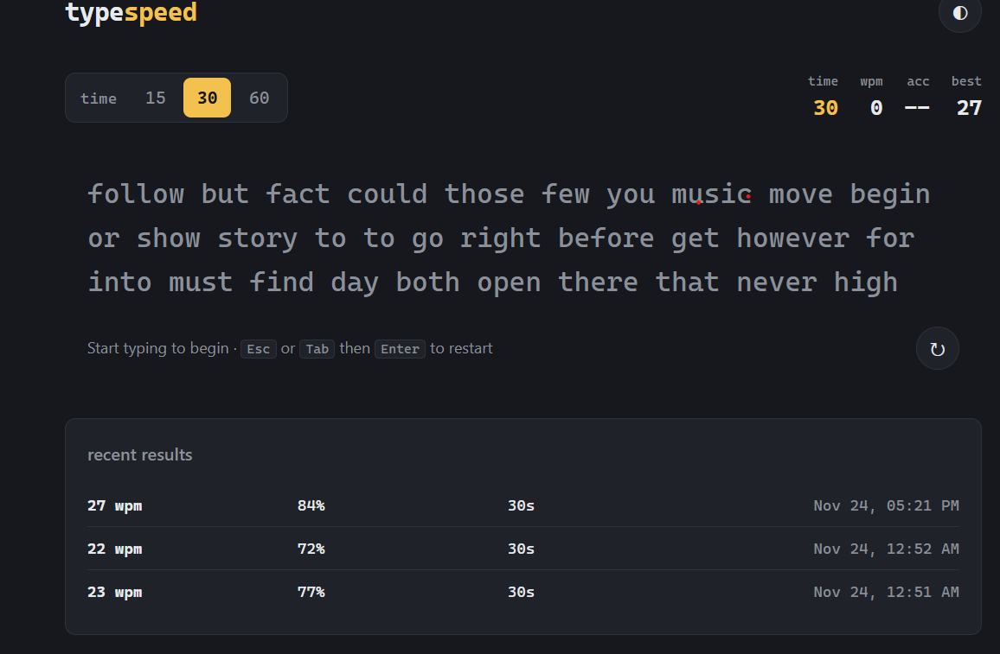

# Typing Speed Tester

A keyboard-first typing speed test built with vanilla HTML, CSS and JavaScript. It has no frameworks, no build step and no dependencies, and it comes with 112 unit tests that run on plain Node.

**Live demo:** [https://prathambasu03.github.io/typing-speed-tester/](https://prathambasu03.github.io/typing-speed-tester/)



## Features

- 15, 30 or 60 second tests
- Live WPM, accuracy and countdown while you type
- Results: WPM, raw WPM, accuracy, correct and incorrect characters
- Personal best for each duration, plus your last 10 results, saved in the browser
- Dark and light themes. Your choice is remembered, and the default follows your system setting
- A smooth caret that scrolls the text line by line. New words are added as you go, so you never run out
- Restart at any time with <kbd>Esc</kbd>, or <kbd>Tab</kbd> to the restart button and press <kbd>Enter</kbd>
- Works with on-screen keyboards on mobile, and down to 360px wide
- Pasting or dropping text is blocked, so the score reflects real typing

## Tech and skills shown

- **State management without a framework.** One `state` object is the single source of truth. Handlers update it, and render functions only write to the DOM.
- **Separation of logic and UI.** All calculations and validation live in `stats.js`, which never touches the DOM. The same file runs in the browser and in Node.
- **Accurate timing.** Elapsed time comes from `performance.now()` timestamps, which are monotonic. Timer ticks only refresh the display, so drift and background-tab throttling do not affect the score.
- **Safe DOM rendering.** All text, including stored data, is written with `textContent`. The code never uses `innerHTML`.
- **Validated persistence.** `localStorage` data is read with guarded JSON parsing and checked on load. Invalid records are dropped and never saved.
- **Careful input handling.** Keys pressed after time runs out are not counted. Browser shortcuts (Ctrl, Cmd, Alt) are ignored, but AltGr characters such as `@` or `€` still type. Mobile and IME input go through a separate `input` event path.
- **Accessibility to WCAG 2.2 AA.** Keyboard-first, with screen reader support, visible focus, at least 4.5:1 text contrast and reduced-motion support. See [Accessibility](#accessibility).
- **Responsive design** down to 360px wide, with no horizontal scrolling.
- **Automated tests** with `node --test`, using only Node built-ins (`node:test`, `node:assert/strict`, `node:vm`). No `npm install` is needed.

## How it works

### Architecture

The page loads three classic `<script defer>` files in order:

1. `words.js` defines the global word list, `WORDS`.
2. `stats.js` defines the pure functions: `calculateWpm`, `calculateAccuracy`, `computeStats`, `isValidRecord`, `isValidDuration`, `randomWords`, `generateChars` and `DURATIONS`. A `typeof module` check also exports them for Node.
3. `script.js` runs the app. It starts with a dependency guard: if `stats.js` failed to load, it shows an error message (announced with `role="alert"`) and stops.

Data flows one way: **event → update `state` → render**. A keystroke updates one character `<span>` instead of re-rendering the text. The spans are built in a `DocumentFragment` and inserted in one operation.

### Test phases

```
idle ──first valid key──▶ running ──timer hits 0──▶ finished
  ▲                                                    │
  └────────────── restart (Esc / restart button) ──────┘
```

### Formulas

A "word" is 5 characters, and minutes are measured from the start timestamp.

- **WPM** = (correct characters ÷ 5) ÷ minutes, rounded
- **Raw WPM** = (all typed characters ÷ 5) ÷ minutes, rounded
- **Accuracy** = correct keystrokes ÷ total keystrokes × 100, rounded down

Accuracy is rounded down so that any mistake keeps it below 100%. Backspace does not undo a mistake in the accuracy count. Every formula guards against division by zero and non-finite values, so `NaN` and `Infinity` never reach the screen.

### Stored data

All `localStorage` keys use the `typing:` prefix:

| Key | Contents |
|---|---|
| `typing:history` | Last 10 results |
| `typing:best` | Best result for each duration |
| `typing:theme` | `light` or `dark` |
| `typing:duration` | Last chosen duration |

A record is only accepted if its WPM is 0 to 1000, its accuracy is 0 to 100, its duration is 15, 30 or 60, and its date is a finite number.

## Accessibility

- **Keyboard:** Tab is never captured, so focus can always move. <kbd>Esc</kbd> restarts from the typing area. Duration buttons expose their state with `aria-pressed`.
- **Focus:** The typing area shows a visible focus ring. The caret hides when the area is not focused, so it never suggests typing works when it does not.
- **Screen readers:** The input is described by a text version of the next 30 words to type (`aria-describedby`). A polite live region announces results, restarts and duration changes. When a test ends, focus moves to the Results heading. Load errors use `role="alert"`.
- **Contrast:** Text contrast is at least 4.5:1 in both themes.
- **Motion:** Caret and scroll animations are turned off when `prefers-reduced-motion` is set.
- **Small screens:** No horizontal scroll at 360px wide.

## Run locally

Open `index.html` in a browser. Or serve the folder with any static server, for example:

```bash
python -m http.server 8000
```

Then visit `http://localhost:8000`.

## Run the tests

Requires Node 18 or later (`describe` and `it` from `node:test` need 18.7+). There is nothing to install.

```bash
node --test tests/
```

If your Node version does not accept a folder, name the file directly:

```bash
node --test tests/stats.test.js
```

The 112 tests cover:

- boundary validation of stored records (for example WPM 1000 is accepted, 1000.1 is not)
- the accuracy floor, so one mistake in 250 keystrokes gives 99%
- WPM and accuracy with zero, negative, `NaN` and infinite inputs
- deterministic word generation through an injected random function
- loading `stats.js` as a classic script with `words.js` in a `node:vm` context with no `document` or `window`, which proves it is DOM-free

## Project structure

```
index.html           page structure: header, settings, typing area, results, history
style.css            theme variables, layout, caret styles, responsive and reduced-motion rules
words.js             the word list (global WORDS)
stats.js             pure logic: stats, validation, word generation (no DOM)
script.js            state, rendering, timer, input handling, persistence
tests/stats.test.js  112 unit tests for stats.js
.nojekyll            tells GitHub Pages to serve the files as they are
```

## Deploy to GitHub Pages

1. Create an empty repository on GitHub, for example `typing-test`.
2. Push this project:
   ```bash
   git remote add origin https://github.com/<your-username>/typing-test.git
   git push -u origin main
   ```
3. On GitHub, open **Settings → Pages**. Under **Build and deployment**, choose **Deploy from a branch**, then pick branch `main` and folder `/ (root)`. Click **Save**.
4. After about a minute the site is live at `https://<your-username>.github.io/typing-test/`.

## What I would add next

- Browser tests for `script.js` (keyboard handling, phases and focus), for example with Playwright
- A GitHub Actions workflow that runs `node --test` on every push
- More test modes: a fixed word count, punctuation and numbers
- A per-second WPM chart on the results screen
